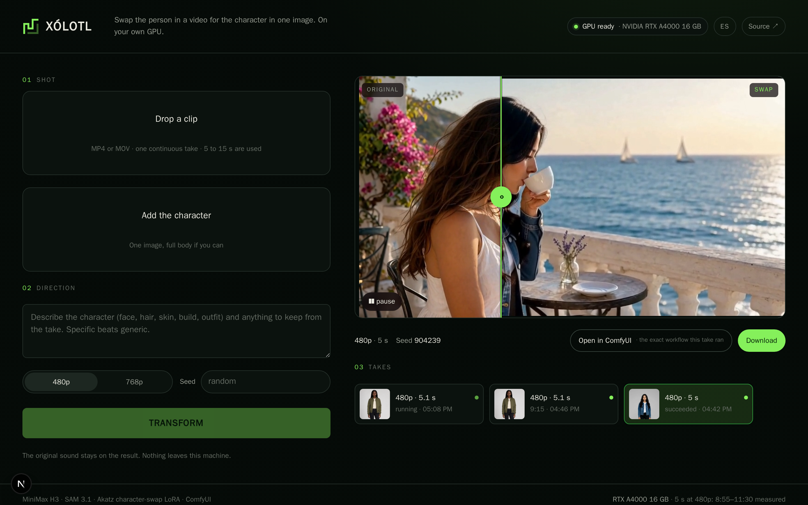

# Xólotl

**Swap the person in a video for the character in one image — on your own GPU, with open weights only. Nothing leaves your machine.**



Xólotl is a small web app in front of your ComfyUI. Drop a 5–15 s clip and one picture of a character, press *Transform*, and the person in the clip becomes that character while the performance, the scene, the camera and the original sound stay exactly as they were. The result comes back at your clip's own size and aspect ratio. It runs the character-swap graph that Comfy's own *Openjutsu* uses — MiniMax H3 with Akatz Labs' character-swap LoRA and SAM 3.1 — but entirely on a 16 GB consumer card, through Comfy's official SDK and API proxy, with no accounts, credits or closed models anywhere in the path.

Built for Comfy's [Open Source Higgsfield Challenge](https://comfy.org/open-source-higgsfield) (the *Openjutsu* prompt). Named after Xólotl, the Mexica god of lightning and transformation, the twin who could take any form.

## What you get

- **The twin view.** Original and swap in one frame with a divider you drag; both videos play in step, so you judge the identity, the scene and the timing in a single look.
- **Your clip's own frame.** The swap is laid back over your original frames at their own size: a 1920×1080 clip comes back 1920×1080, a vertical clip comes back vertical, and only the person is regenerated.
- **The model's pixels go to the person.** A first pass finds and tracks the person on the whole frame; the model then works on a crop around them, so a person who fills a third of a 1080p frame is swapped at their native resolution instead of half of it. Measured on the terrace clip: 12 % more fine detail on the person for 6 % more time.
- **Takes.** Every finished swap stays on disk with its character, its settings and the exact workflow JSON that ran — download the video, or the workflow together with its clip and character (named as the workflow expects them) to run the same graph in ComfyUI yourself.
- **Honest status.** Where the take is (preparing, reading, generating, assembling), the sampler's step and, for longer parts, the window, how long it has run and about how long it has left. The step comes from ComfyUI's own log, since the API proxy does not relay per-node progress, and the time left from the step time ComfyUI measures plus the timings in [docs/measurements.md](docs/measurements.md). Queue position and live GPU load too; *Stop* cancels the take through the same API; opening the app, here or in another browser on the LAN, shows a running take at once. A health pill tells you up front if a node or a model is missing (`npm run doctor` does the same from the terminal).
- **Two bundled takes** made with open models (a clip from MiniMax H3, characters from Qwen-Image), so the first run needs no upload.
- English and Spanish interface.

## Measured on an RTX A4000 (16 GB)

| Through the app, 480p | Time | Result |
|---|---|---|
| 5.1 s part, default recipe, person framed | **5 min 08 s** | 1344×768, the clip's own size |
| 10 s part, default recipe, person framed, two 124-frame windows | **10 min 47 s**, before the two nodes that save time | 1344×768, the clip's own size |
| 5.1 s part at 768p, the person at native resolution | **7 min 58 s** | 1344×768, the clip's own size |
| 5.1 s part, the reference graph's settings: fp8 H3, 8-step turbo LoRA | 11 min 46 s | 928×512, the pack's canvas |

The default recipe is MiniMax H3 `ref2va` in int8 with the ref2v 4-step turbo LoRA, the int8 video VAE and Veda sparse attention (79 % at 480p, its trained budget at 768p, where it is 9 % faster per step). Same clip, character and seed in every row; times are ComfyUI's own (`execution_start` → `execution_success`), and the 5.1 s take started from a freshly restarted ComfyUI, so it includes loading every model and tracking the person. The app's estimate before a take is a range built from these runs. The recipe was picked one change at a time, keeping the colours of the reference take: a faster community merge was dropped because it turned the jacket greener. ComfyUI's dynamic VRAM keeps the 16 GB card full in every run, and ComfyUI's container peaked at 48 GiB of RAM at 480p and 50 GiB at 768p (sampled every 10 s). Details, the runs behind the choice and how the time breaks down: [docs/measurements.md](docs/measurements.md).

## Requirements

- An NVIDIA GPU with 16 GB of VRAM or more, and 64 GB of system RAM.
- [ComfyUI](https://github.com/comfyanonymous/ComfyUI) 0.41 or newer (the MiniMax H3 and SAM 3.1 nodes are built in), reachable from this machine. The int8 weights need PyTorch on CUDA 13, where ComfyUI turns on comfy-kitchen's int8 kernels; on an older CUDA, install the fp8 weights with `--fp8`. Veda's sparse attention needs Triton, which ships with PyTorch on Linux.
- `ffmpeg` and `ffprobe` where ComfyUI runs: the swap pack and Xólotl's nodes call them.
- Python 3.10+ (for the Comfy API proxy), Node.js 22+, `git`, and the Hugging Face CLI (`pip install -U huggingface_hub`) for the model downloads.
- About 44 GB of disk for the models.

## Install

```bash
git clone https://github.com/Mguelon/xolotl.git && cd xolotl
npm ci

# 1. The nodes: Xólotl's own six, Akatz Labs' character-swap pack (GPL-3.0) and Veda, pinned to the tested revisions
scripts/install-nodes.sh /path/to/ComfyUI

# 2. The models (~44 GB, open weights; read each model card's licence)
scripts/install-models.sh /path/to/ComfyUI            # add --fp8 if your ComfyUI's PyTorch is not on CUDA 13

# 3. Restart ComfyUI so it loads the nodes, then put the official Comfy API v2 proxy in front of it
pip install comfy-api-proxy
comfy-api-proxy run --comfyui http://127.0.0.1:8188 --port 8192

# 4. Point the app at the proxy and check everything
cp .env.example .env.local                             # COMFY_BASE_URL=http://127.0.0.1:8192
npm run doctor

# 5. Run
npm run dev                                            # http://localhost:3000
```

If ComfyUI runs in Docker, `custom_nodes/` and `models/` are usually bind mounts: pass the host paths to the scripts, or copy the nodes in with `docker cp`. The proxy binds to loopback; keep it that way unless you add a bearer token.

The app runs whatever your ComfyUI has: the fp8 files when the int8 ones are missing, and no Veda when its node is missing. To try another H3 build you have, set it by environment instead of editing the workflow:

```bash
XOLOTL_UNET=<a file in models/diffusion_models> npm run dev
# also: XOLOTL_TURBO_LORA, XOLOTL_SWAP_LORA
```

## How it works

```
browser ── Next.js route handlers ── @comfyorg/sdk ── comfy-api-proxy (Comfy API v2) ── your ComfyUI
                                        │
                                 workflows/swap.api.json
```

1. The browser uploads the clip and the character to the app (`POST /api/jobs`), together with the part to use (start, length), the quality (480p / 768p), a seed and an optional direction. The same endpoint also takes `steps` (1–100, default 4) and `turbo=off`, which drops the 4-step turbo LoRA and samples H3's full schedule as the official template does; the interface does not expose them yet.
2. `lib/swap.ts` fills the workflow template: the clip into `LoadVideo`, the character into `LoadImage`, the part into the `Video Slice` and `PrepareVideo` nodes, the prompt and seed into the swap settings. The SDK uploads the files as assets and submits the graph to the proxy, which runs it on ComfyUI.
3. In the graph, Xólotl's *Fit Clip on Canvas* puts the whole part on the model's canvas: the 32-pixel grid within the 480p (0.5 MP) or 768p (1 MP) budget, the clip's aspect ratio kept and the few leftover pixels mirrored, so nothing is cut. SAM 3.1 finds the person in the first frame and tracks them through the clip. Xólotl's *Frame the Person* turns those masks into a crop around the person, with 20 % of room and a phone-like aspect ratio, and a second *Fit Clip on Canvas* puts that crop on the canvas: the pixels go to the person, up to their native resolution. The first pass's masks are carried onto that canvas (the person is tracked once), and Xólotl's *Grow the Person's Mask* expands them by 64 px, the same masks as the pack's own node in an eighth of the time. MiniMax H3 `ref2va` regenerates only the masked tokens with the character image as reference, the character-swap LoRA v1.5, the 4-step ref2v turbo LoRA and Veda sparse attention, in 124-frame windows (a 10 s part is two windows that share 18 frames); Xólotl's *Reuse VAE Encodes* spares the first window a second encode of the very frames it has just encoded. Xólotl's *Restore Clip Size* then scales the swap back to the crop's size and lays it over the clip's own frames at the crop's place, through the same mask, with the source audio: the result has your clip's size and aspect ratio, and everything outside the person is your original footage.
4. The app polls the job (`GET /api/jobs/:id`), shows the queue position, the stage and step it reads from ComfyUI's log (`/internal/logs/raw`, `lib/stage.ts`), the elapsed and remaining time and the GPU load, and when the job succeeds stores the result next to the clip, the character and the workflow in `data/takes/<job id>/`.

The prompt always starts with Xólotl's own instruction, *Replace the selected person in `<Video 1>` with the character in `<Picture 1>`. Keep the reference character's face, hair and clothing. Follow the source performance's pose, gaze, blinking, facial expressions and visible mouth movements moment by moment. Preserve the scene and the audio timing.*, and your direction is appended. Describing the character's face, hair, skin, build and outfit works much better than a generic "replace the person" (the authors of the workflow say the same, and our takes agree). The facial performance needs words too: on a clip where the performer purses her lips and blows kisses, the body and hands followed the clip in every take, but the face stayed neutral until the direction said *she purses her lips and blows kisses to the camera*; the generic list of things to keep did not do it on its own (docs/measurements.md, "Facial expressions").

## Which parts of ComfyUI

Core ComfyUI nodes (MiniMax H3, SAM 3.1, video), Akatz Labs' `h3_character_swap` node pack, Veda's sparse-attention node, six nodes of Xólotl's own (`comfy_nodes/xolotl`), the **Comfy SDK** (`@comfyorg/sdk` 0.5.0, TypeScript) and the **Comfy API v2** served by the official self-hosted proxy (`comfy-api-proxy` 0.1.6). The same code runs unchanged against Comfy Cloud or a Developer Platform deployment: set `COMFY_BASE_URL` and `COMFY_API_KEY`.

## The stack is fully open

| Piece | Licence |
|---|---|
| MiniMax H3 `ref2va` weights (int8 convrot), Qwen3-VL text encoder, video and audio VAEs ([Comfy-Org/MiniMax-H3](https://huggingface.co/Comfy-Org/MiniMax-H3)) | MiniMax H3 Community License (its standard grant excludes some regions — read the card) |
| Character-swap LoRA v1.5 ([akatz-ai/MiniMax-H3-Character-Swap-LoRA](https://huggingface.co/akatz-ai/MiniMax-H3-Character-Swap-LoRA)) | MiniMax H3 Community License |
| Ref2V turbo 4-step LoRA v0.1 ([lightx2v/Minimax-h3-Turbo](https://huggingface.co/lightx2v/Minimax-h3-Turbo), packaged in Comfy-Org/MiniMax-H3) | see model card |
| Veda R2VA sparse-attention predictor ([Veda-Sparse/Minimax-H3-R2VA-Veda-Preview](https://huggingface.co/Veda-Sparse/Minimax-H3-R2VA-Veda-Preview)) | MiniMax H3 Community License |
| Veda node ([veda-sparse/Veda-on-ComfyUI](https://github.com/veda-sparse/Veda-on-ComfyUI), installed by script) | MIT |
| Xólotl's six nodes (`comfy_nodes/xolotl`) | MIT |
| SAM 3.1 ([Comfy-Org/sam3.1](https://huggingface.co/Comfy-Org/sam3.1)) | see model card |
| `h3_character_swap` node pack ([akatz-labs/h3-character-swap-tool](https://github.com/akatz-labs/h3-character-swap-tool), installed by script, not vendored) | GPL-3.0 |
| The character-swap workflow (same repository) | MIT |
| `comfy-api-proxy`, `@comfyorg/sdk` | MIT |
| This app (derived from [Comfy-Org/comfy-openjutsu](https://github.com/Comfy-Org/comfy-openjutsu), MIT) | MIT |

No partner nodes, no closed API in the path. The first-frame "anchor" that Comfy's reference app makes with GPT Image is simply not needed here: the swap holds the identity on its own in our takes.

## Limits

One continuous shot, with the person visible in the first frame; with several people the largest one is swapped. Parts of 5 to 15 s; longer clips are trimmed to the part you choose. The original soundtrack is kept, not regenerated. Expect about 5 min per 5 s and 10 to 11 min per 10 s at 480p on a 16 GB card, and about 8 min per 5 s at 768p (see the measurements). In a band about 64 px wide around the person the background is regenerated at the model's resolution, so it can be a little softer than the rest of the frame.

## Credits

[Akatz Labs](https://github.com/akatz-labs) for the H3 character-swap workflow, LoRA and nodes; [Comfy Org](https://comfy.org) for ComfyUI, the SDK, the proxy and the Openjutsu reference app this one started from; MiniMax, Meta (SAM) and lightx2v for the models. Xólotl by Miguel Ángel López Carrizales (Matamoros, Tamaulipas, México), MIT.

---

**En español.** Xólotl cambia a la persona de un video por el personaje de una imagen, en tu propia GPU y solo con modelos abiertos: nada sale de tu máquina, y el resultado regresa del tamaño y la proporción de tu clip. La interfaz está en inglés y español; la instalación de arriba es la misma. Es la entrada al *Open Source Higgsfield Challenge* de Comfy (la idea «Openjutsu»).
